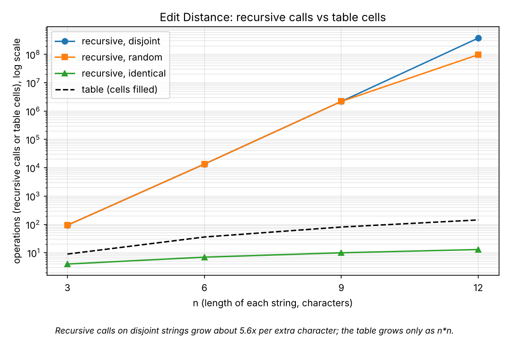
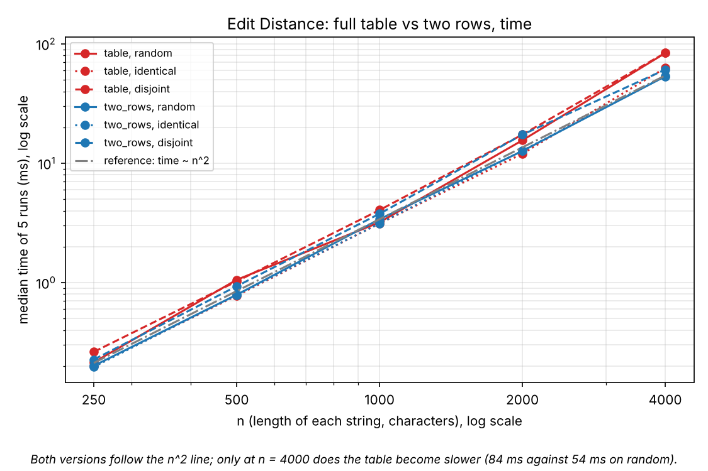
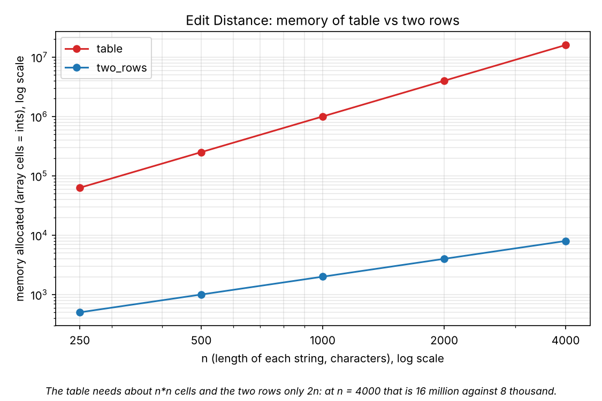
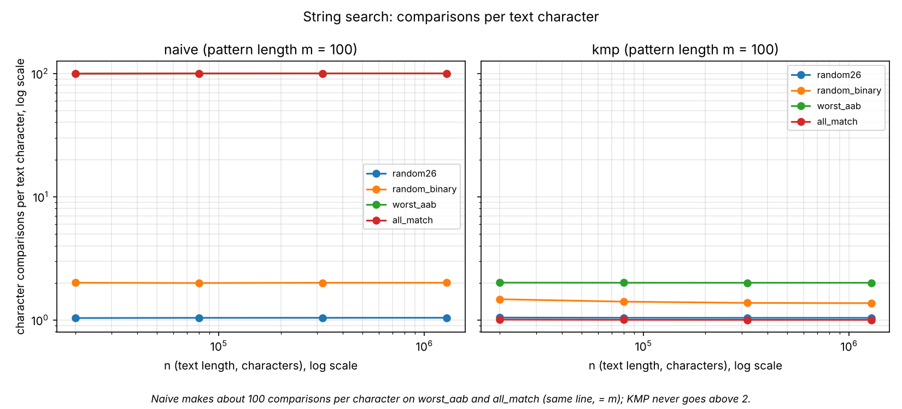
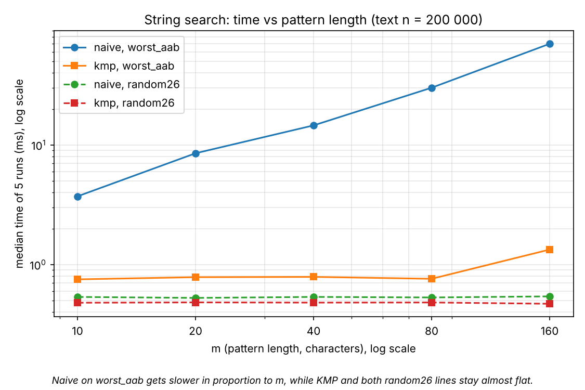

# Assignment 4 - Dynamic Programming and String Algorithms

Scenario: City Search & Spell-Check.

All numbers below come from `results/results.csv` (Java 21, one run of `experiment.Experiment`, fixed seed).
Counters are exact and repeat on every machine; times are the median of 5 runs and depend on the machine.

## 1. Experiment Design Card (written before the first run)

| Field | Content |
|---|---|
| Question (Edit Distance) | Does the recursive version really explode exponentially while table and two rows grow like n*m? Does the content of the strings change the cost of each version? |
| Question (String search) | Does Naive really reach n*m comparisons on a bad input while KMP stays near n? Is KMP also faster on the clock for ordinary random text? |
| Sizes (Edit Distance) | Recursive vs DP: n = 3, 6, 9, 12 (n = 12 is already about 4e8 calls on the worst input; larger would take minutes). DP only: n = 250, 500, 1000, 2000, 4000 (16x range, 16 million cells at the top, a table of 64 MB). |
| Sizes (search) | Text length n = 20 000, 80 000, 320 000, 1 280 000 with pattern length m = 100 (64x range). Second sweep: n = 200 000 and m = 10, 20, 40, 80, 160 (16x range). |
| Inputs (Edit Distance) | `random`: two random strings over 26 letters (typical case). `identical`: b = a (best case for recursion, the diagonal is always taken). `disjoint`: a = "aaa...", b = "bbb..." (no common letter, worst case for recursion). |
| Inputs (search) | `random26`: random text and pattern over 26 letters (typical). `random_binary`: alphabet {a,b}, many partial matches. `worst_aab`: text a^n, pattern a^(m-1)b (worst case for Naive). `all_match`: text a^n, pattern a^m (every position matches, matches overlap). |
| Metrics | Edit Distance: `operations` (recursive calls or table cells filled), `memory_cells` (array cells allocated), `time_ms`. Search: character comparisons (LPS build included for KMP) and `time_ms`. Operations show the cost without noise; memory shows what two rows save; time shows what a user would feel. |
| Prediction | Recursive: `disjoint` grows about 5.8x per extra character, `identical` grows linearly (n+1 calls), `random` is in between. Table and two rows: operations = n*m on every input, time x4 when n doubles, memory (n+1)(m+1) vs 2(m+1). Naive: `random26` about 1.04n comparisons, `random_binary` about 2n, `worst_aab` and `all_match` about m*n = 100n. KMP: at most 2n on every input. Time: Naive on the worst inputs is much slower than KMP; on `random26` Naive may be as fast as KMP because its loop is simpler. |
| Plots | 1. Recursive calls vs n per input, log y: how bad is the explosion and does the input matter. 2. Table vs two rows, time vs n, log-log: does saving memory cost time. 3. Memory cells vs n, log-log: what two rows save. 4. Comparisons per text character vs n, log y: Naive vs KMP on all inputs. 5. Time vs pattern length m, log-log: how m hurts Naive and not KMP. |

Changes to the card after the runs: none.

## 2. Plots and Results

Plot 1. Recursive calls on `disjoint` strings grow about 5.6x per extra character; the table grows only as n*n.

Plot 2. Both versions follow the n^2 line; only at n = 4000 does the table become slower (84 ms against 54 ms on `random`).

Plot 3. The table needs about n*n cells and the two rows only 2n: at n = 4000 that is 16 million against 8 thousand.

Plot 4. Naive makes about 100 comparisons per character on `worst_aab` and `all_match` (same line, = m); KMP never goes above 2.

Plot 5. Naive on `worst_aab` gets slower in proportion to m, while KMP and both `random26` lines stay almost flat.

## 3. Prediction vs Result

**Edit Distance.**

- Recursive calls: confirmed. On `disjoint` the calls grew from 2 193 844 (n = 9) to 377 393 953 (n = 12), which is 5.56x per character. This is a little under the predicted 5.83x because the ratio approaches 5.83 only for large n. `identical` needed exactly n+1 calls (13 at n = 12).
- `random`: the prediction "in between" was only half right. For n = 3, 6 and 9 `random` had exactly the same number of calls as `disjoint` (94, 13 483, 2 193 844), because with 26 letters a matching pair is rare in short strings. Only at n = 12 did it fall behind: 97 828 825 calls against 377 393 953.
- Table and two rows: `operations` = n*m on every input (for example 16 000 000 at n = 4000), so the cost of the DP does not depend on the content. Memory was (n+1)(m+1) and 2(m+1) as predicted.
- Time: predicted x4 when n doubles. The two-row version gave x4.2 (12.7 ms to 53.5 ms from n = 2000 to 4000, `random`), the table x5.4 (15.6 ms to 83.8 ms). I did not test why the table grows faster; the extra memory it touches is a plausible reason, but this is a guess.
- Same counter, different time: at n = 4000 the table took 62.9 ms on `identical` and 84 ms on `random` and `disjoint`, although all three fill 16 million cells. The counter does not see this; I did not investigate the cause.

**String search.**

- Counters: confirmed. Naive made 1.04n (`random26`), 2.00n (`random_binary`) and 99.99n (`worst_aab`, `all_match`) comparisons at n = 1 280 000, and for `worst_aab` exactly (n-m+1)*m = 127 990 100. KMP made at most 2.000n (`worst_aab`), 1.37n on `random_binary`, 1.04n on `random26`.
- `all_match` for KMP: I expected up to 2n, but KMP needed only 1.00n here, because there is no mismatch at all. The worst input for KMP was `worst_aab`, not `all_match`.
- Time on the worst inputs: confirmed. At n = 1 280 000 Naive took 236 ms on `worst_aab` and KMP 5.0 ms (47x).
- Time on `random26`: Naive and KMP are about equal (3.55 ms and 3.10 ms at n = 1 280 000). At n = 80 000 KMP was slower (1.17 ms against 0.22 ms), but timings below a millisecond are noisy on one JVM run, so I draw no conclusion from that point.
- Surprise: for both algorithms `all_match` took longer than `worst_aab` (Naive 275 ms against 236 ms, KMP 32.5 ms against 5.0 ms) although KMP made fewer comparisons there. The only difference is the output: `all_match` returns 1 279 901 indices. My explanation is that building this list costs time that the comparison counter does not count; I did not measure it separately.
